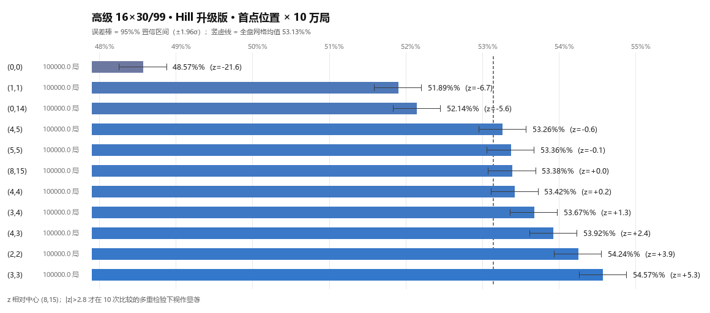
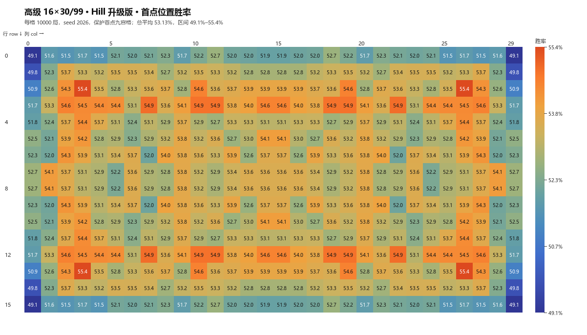
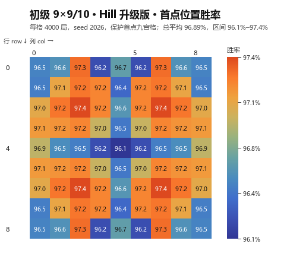
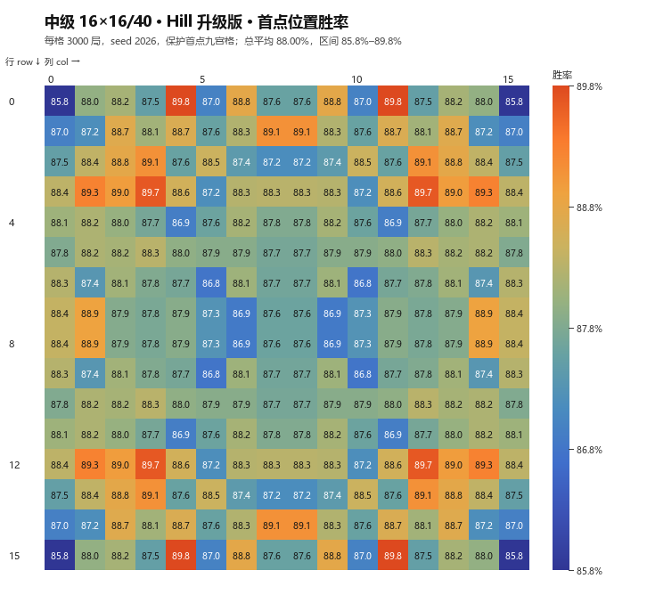

# 扫雷里三个有趣的问题：点哪里、怎么发牌、以及"作弊一次"

> 第二篇。三个问题我都实测过，样本加起来大约 370 万局。
>
> 统一口径：高级 16×30/99，除非另说；求解器是 Hill 升级版（Java，`LARGE_ADAPTIVE_ANALYSIS`）；首点九宫格保证无雷；"赢"= 所有非雷格翻开且没有错标雷。

## 〇、先给三个坐标

| 难度 | 胜率 | 猜测/局 | 样本 |
|---|---|---|---|
| 初级 9×9 / 10 | 96.81% | 0.14 | 100,000 |
| 中级 16×16 / 40 | 88.00% | 0.54 | 192,000 |
| 高级 16×30 / 99 | **54.59%** | **2.65** | 150,000 |

注意最后一列：高级盘平均要猜 2.65 次。1 万张高级盘里只有 **16.2%** 完全不用猜，其余都得赌。如果假设"活过第一猜之后一律算赢"，宽松上界是 85.37%——所以**胜负几乎全压在"猜"上**。

下面三个问题，就是围绕"猜"展开的。

---

## 一、第一个有趣的问题：第一下点哪里，值 6 个点

同一张盘、同一个求解器，只是开局第一下点的位置不同，胜率能差多少？我陆陆续续跑了四组。

### 1.1 先扫全盘：480 个点，每点 500 局

| 分组 | 格数 | 局数 | 胜率 | 猜测/局 |
|---|---|---|---|---|
| 四个正角 | 4 | 2,000 | **48.35%** ±2.19 | 3.15 |
| 贴边（第 0 行/列） | 88 | 44,000 | **51.72%** ±0.47 | 2.92 |
| 距边 1 格 | 60 | 30,000 | 52.86% ±0.49 | 2.72 |
| 内部（≥2 格） | 312 | 156,000 | **53.62%** ±0.25 | 2.67 |

网格总平均 53.15%。贴边 vs 内部 **z=5.79**。

单格胜率的标准差 2.42%，纯二项分布应该是 2.23%（比值 1.08）——**热力图上的花斑基本是噪声，唯一稳定的结构是"越靠边越低"**。

### 1.2 再加密：只测左上 1/4 盘

既然左右、上下高度对称，就把样本集中到一角，每格从 500 局提到 833：

| 分组 | 胜率 | 猜测/局 |
|---|---|---|
| 正角 (0,0) | **48.86%** ±3.39 | 3.18 |
| 贴边 | **51.93%** ±0.72 | 2.90 |
| 距边 1 格 | 52.32% ±0.76 | 2.72 |
| 内部（≥2） | **53.72%** ±0.38 | 2.68 |

总数和 1.1 一模一样（53.15%），贴边 vs 内部 z=4.28——**"对称"这个假设成立**，后面可以放心只测一角。

### 1.3 定点爆破：11 个点 × 10 万局

真正想比的是"哪个点最好"，于是挑了 11 个点各跑 10 万局：

| 位置 | 胜率 | 猜测/局 | 步数/局 |
|---|---|---|---|
| **(3,3)** | **54.57%** | 2.65 | 183.3 |
| (2,2) | 54.24% | 2.70 | 180.3 |
| (4,3) | 53.92% | 2.66 | 183.2 |
| (3,4) | 53.67% | 2.68 | 183.6 |
| (4,4) | 53.42% | 2.70 | 184.2 |
| (8,15) 中心 | 53.38% | 2.67 | 189.1 |
| (5,5) | 53.37% | 2.69 | 185.8 |
| (4,5) | 53.26% | 2.71 | 184.9 |
| (0,14) 边中点 | 52.14% | 2.88 | 183.0 |
| (1,1) | 51.89% | 2.89 | 175.1 |
| **(0,0) 正角** | **48.57%** | 3.17 | 163.0 |

（3,3）比中心高 **1.19 点（z=5.3）**，比正角高 **6.0 点（z=21.6）**。

*每点 10 万局，误差棒是 95% 置信区间；虚线是全盘网格均值 53.13%。*

### 1.4 换一批新种子复核

怕 (3,3) 是运气，用全新种子各跑 5 万局：

| 位置 | 主实验（10 万） | 复核（5 万） | 合并 15 万 |
|---|---|---|---|
| (3,3) | 54.57% | **54.85%** | **54.59%** |
| (2,2) | 54.24% | 54.36% | 54.14% |
| 中心 | 53.38% | 53.14% | 53.27% |

（3,3）− 中心 = **+1.32 点（z≈7.2）**；（3,3）− (2,2) = +0.45（z≈1.6），这两个点统计上分不出胜负。**猜测次数与位置几乎无关**（2.65 / 2.67 / 2.71）——位置影响的是"每次猜多危险"，不是"猜几次"。

*每格 10,000 局，一位小数，未平滑。*

### 1.5 为什么是 (3,3)：两个机制在打架

在"第一下"那一刻用纯棋盘模拟量了三件事（2,000–4,000 盘，不经求解器）：

| 位置 | 首点翻开格数 | 前沿数字个数 | 立即可推步数 | **开局被未知区包住的比例** | 胜率 |
|---|---|---|---|---|---|
| (0,0) | **15.9** | 8.7 | 2.1 | 0% | 48.57% |
| (0,14) | 24.9 | 14.9 | 3.3 | 0% | 52.14% |
| (1,1) | 23.5 | 11.5 | 3.0 | 0% | 51.89% |
| (2,2) | 28.8 | 16.2 | 4.6 | 12.9% | 54.24% |
| **(3,3)** | **33.0** | 19.8 | 5.2 | **32.5%** | **54.57%** |
| (4,4) | 36.5 | 22.6 | 5.8 | 49.7% | 53.42% |
| (5,5) | 37.6 | 23.9 | 5.8 | 64.2% | 53.37% |
| (8,15) 中心 | **40.5** | 26.3 | 6.2 | **85.3%** | 53.38% |

**机制一：翻开面积决定信息量。** 角落九宫格被边界裁掉，平均只翻开 15.9 格；内部能开 33–40 格。11 个位置的"翻开格数 vs 胜率"相关系数 **r = 0.79**——正角的 48.6% 基本就是"信息太少"。

**机制二：越靠中间，越容易被"包死"。** 从 (3,3) 往中心走，开局越开越大，但未知区开始把开局整个包住（0% → 85.3%）。前沿变成闭环后，远端只能靠"总共还剩几颗雷"间接约束，推到最后一格时局部证据最弱。

两个机制相抵，最优点落在**"开得够大、但还没被包死"**的地方——高级盘就是 (3,3)。

### 1.6 缩放到初级 / 中级

同一套流程，全盘逐格：

| 难度 | 每格样本 | 总体 | 最好的点 | 正角 | 最差点 |
|---|---|---|---|---|---|
| 初级 9×9/10 | 4,000 | 96.81% | **(2,2) 97.38%** | 96.50% | (4,4) 96.13% |
| 中级 16×16/40 | 3,000 | 88.00% | (0,4) 89.83%、(3,3) 89.70% | **85.80%** | (6,5) 86.80% |
| 高级 16×30/99 | 10,000 | 53.13% | **(3,3) 54.57%** | **48.57%** | — |

规律：最优点 ≈ **距角 `0.2 × min(行, 列)` 格**——9 格取 2，16 格取 3，也就是"从角往里数两到三格"。

但**效应量随难度急剧缩小**：高级 6.0 点，中级 3.9 点（且只有正角一个是 2.5σ 的坏点，内圈彼此在噪声内），初级只有 1.25 点。初级每局只猜 0.14 次，可影响的余地本来就小。

**一句话：初级/中级"别点正角"就够了；高级才值得专门挑 (3,3)。**

---

## 二、第二个有趣的问题：规则不同，"首点"这个词的含义就变了

同样是"第一次点击"，游戏（或模拟器）可以给出完全不同的保证。我把六种常见规则放在同一个判定下比，每档 5,000–10,000 局：

| 首点保护规则 | 胜率 | 猜测/局 | 相对默认 |
|---|---|---|---|
| **3×3 无雷（现代默认）** | **51.19%** | 2.68 | — |
| 3×3 无雷 + 外圈还有一个 0 | 51.50% | 2.59 | +0.31（不显著） |
| 5×5 无雷 | **47.82%** | 2.62 | **−3.37** |
| 3×3 里只有中心是 0 | 44.36% | 4.22 | −6.83 |
| 只保证首格不是雷（经典规则） | **34.23%** | 4.18 | **−16.96** |
| 完全不保护（可能首点就炸） | **27.41%** | 3.29 | **−23.78** |

三个反直觉的结论：

1. **"第一下开出空的区域"值 17 点。** 在"只保证不是雷"的规则里，首点碰巧开出空区的 1,621 局胜率 **50.40%**，只翻出一个数字的 8,379 局 **31.10%**。差距全在"有没有信息"。
2. **开得更大反而更差：5×5 无雷比 3×3 无雷低 3.4 点。** 5×5 一次性排掉 25 格无雷，但 99 颗雷被挤进更小的剩余区域，密度从 21.0% 涨到 21.8%——开局多给的信息，抵不过全局密度上升。
3. **"外圈再多一个 0"几乎没用**（+0.31 点、z≈0.44）。因为 3×3 规则下 **95.1%** 的盘本来就满足这个条件，加码只改了 4.9% 的盘。

**这一节最实用的结论：经典规则与现代规则差 17 点，几乎相当于"少猜 1.5 次"的价值。** 网上流传的扫雷胜率数字之所以差得离谱（30% / 40% / 54%），一半原因在这里。

---

## 三、第三个有趣的问题：如果允许作弊一次

设想一个不允许存在的规则：**给你一次"免死"——当算法要下"必死"的一手（该格在全部自洽雷图里都是雷）时，允许改选一个"保证安全、且邻域里 0 最多"的格子**。棋盘不变，只在"必须赌"的那一刻换一格。

它当然不是真实规则，但它量出了一件一直没人算清的事：**"赌一次"到底值多少胜率。**

| 首点规则 | 0 次 | 1 次（+） | 2 次（+） |
|---|---|---|---|
| 3×3 无雷（默认） | 51.19% | 79.54%（**+28.35**） | 91.78%（+12.24） |
| 3×3 无雷 + 外圈 0 | 51.50% | 79.84%（**+28.34**） | 91.64%（+11.80） |
| 5×5 无雷 | 47.82% | 75.58%（**+27.76**） | 88.62%（+13.04） |
| 3×3 里只有中心是 0 | 44.36% | 77.26%（**+32.90**） | 91.46%（+14.20） |
| 只保证首格不是雷 | 34.23% | 70.00%（**+35.77**） | 88.64%（+18.64） |
| 完全不保护 | 27.41% | 36.64%（+9.23） | 46.24%（+9.60） |

四件值得记下来的事：

1. **第一刀最贵。** 默认规则下，一次免死 **+28.4 点**，第二次只 **+12.2 点**（四成）。越往后，"能靠推理解决"的比例越高。
2. **规则越差，免死越值钱。** "只保证首格不是雷"规则下一次值 **+35.8 点**，因为它开局信息少、后面必死局更多；默认规则只值 +28.4。
3. **"完全不保护"是唯一不听话的**（只 +9.2）。原因很实际：这类盘有 **20.6% 在第一下就炸了**，而免死只作用于求解器的猜测，管不到发牌阶段；剩下的局又普遍开局没信息，免死一次也堵不住后面的连续赌博。
4. **两次免死仍留下 8.2% 的败局**（91.78%）。这不是"免死不够用"，而是**有些局面里根本不存在"可证明安全"的格子**——只剩 50/50 或两三选一的死局，免死找不到替代品，只能硬猜。

一句话：**现代规则下，一局比赛值大约 28 个百分点；这笔钱只能买一次，第二次只值四成。**

---

## 四、把三个数字排在一起

| 变量 | 能值多少胜率 | 备注 |
|---|---|---|
| **首点保护规则**（完全不保护 → 3×3 无雷） | **+23.8 点** | 规则决定游戏难度，比算法影响大得多 |
| **一次免死**（3×3 规则下） | **+28.4 点** | 人为设定，用来度量"一次冒险"的代价 |
| **首点位置**（正角 → (3,3)，高级） | **+6.0 点** | 中级 3.9 点、初级 1.25 点 |
| 求解器实现差异（我这套 Python ↔ Hill） | ~2.2 点 | 同规则、中心开局：51.19 vs 53.38 |
| 猜法改进（十几种里最好的一种） | +0.67 点 | `progress`，z=2.42 |

这张表的读法：**同一个"游戏"，规则能值 24 点、位置能值 6 点，而我们这些写算法的人折腾一年，最好的一项只值 0.67 点。** 这不是说算法没意义——54% 到 55% 已经是很贵的 1 个点——而是说**比较不同文章里的扫雷胜率之前，先看它的规则和首点**。

另外一个反直觉点：**猜得少 ≠ 赢得多**。我把两个成熟实现放在同一批盘上跑了：

| 实现 | 胜率 | 猜测/局 | 动作数/局 |
|---|---|---|---|
| Hill（Java，五层） | **54.59%**（15 万局） | 2.65 | 183 |
| EdLogg（C++） | **53.97%**（50 万局） | **2.28** | 209 |

EdLogg 每局少猜 0.37 次，但赢了更少——他把"少猜"换成了"更激进地推进"，代价是每次猜更危险。

---

## 五、这些数是怎么测出来的

1. **不跨发牌器比较。** 同一个求解器换发牌器能差 1 个点；同一个发牌器换首点规则能差 24 个点。所有"A 比 B 强"都在同一批盘上做。
2. **n ≥ 1,000 起步，结论至少 5,000 局。** 高级盘 100 局的波动能到 ±3 点：同一配置分块跑出来是 94 / 92 / 94 / 96 / 97 / 97 / 98 / 95 / 96 / 97。我早期被 200 局的"提升 2 个点"骗过好几次。
3. **配对检验。** 同一批盘跑 A/B，用 McNemar 只看"只有 A 赢 / 只有 B 赢"的盘，方差小得多。
4. **"猜测次数"要先说清口径。** 有人按"调用猜测例程的次数"算，有人按"踩到雷的那一手"算；更麻烦的是，有些实现在"其实已经能推出来"的局面也会调用猜测例程（我拿精确表复核过 EdLogg 的每一步，发现他大量"猜测"其实是可证明的确定格）。两个口径能差 0.3 次/局。

---

## 六、还没回答的问题

1. **"少猜一次"到底怎么做到。** 模型上 `q^n` 里 `n` 每减 1 约值 +5 点，但我试过的所有代理指标都失败——中盘 88% 的决策点算不出"整局还剩几次必猜"。
2. **端局精确搜索的收益上限。** 放宽门槛实测 ±0：它只影响"猜哪一格"，不影响"要不要猜"。
3. **不同发牌器的 1 点差异从哪来。** 我们的、Hill 的、EdLogg 的三种发牌器在同一条规则下差 0.8~1.1 点，怀疑是 RNG 与"首点九宫格"的定义细节，没做下去。
4. **首点位置的理论最优。** (3,3) 是 480 格里实测出来的经验最优点，没有人给出过"给定棋盘尺寸/雷数时最优首点"的解析解。

---

*数据与脚本：`docs/benchmarks/`（热力图、位置表、复核数据、`bigrun/STATE.md`）、`tools/hill_heatmap*.py`、`tools/first_click_ab.py`。算法细节见第一篇。*
